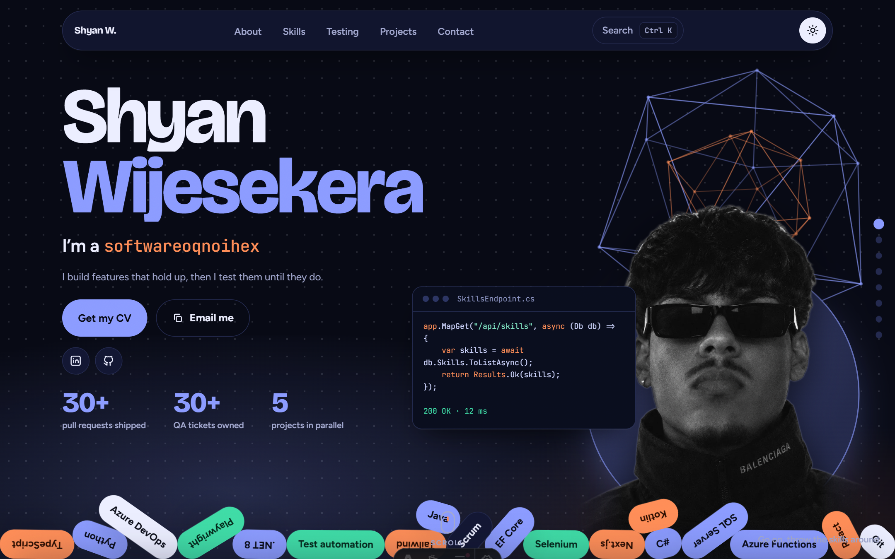
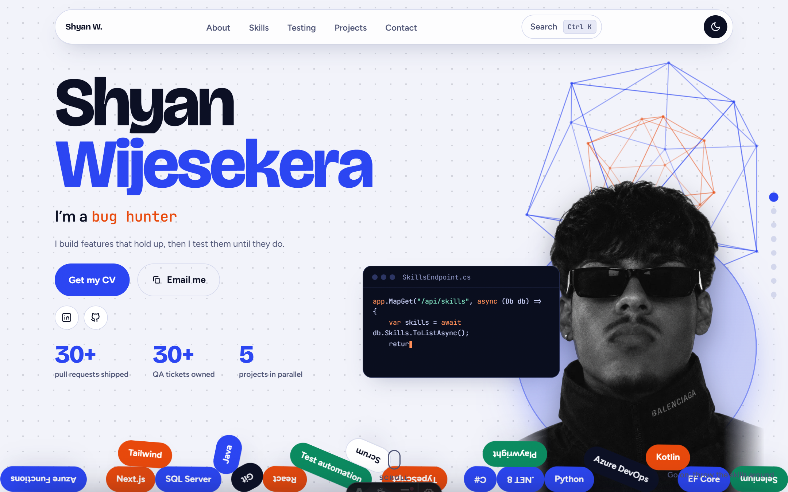
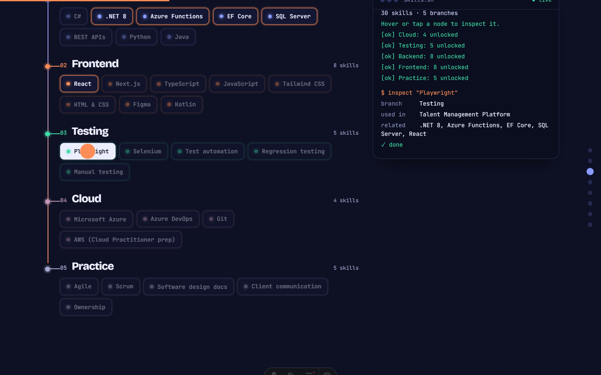
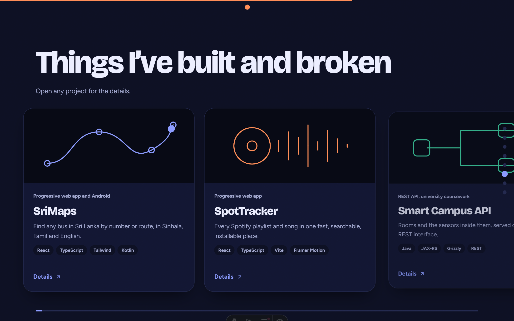
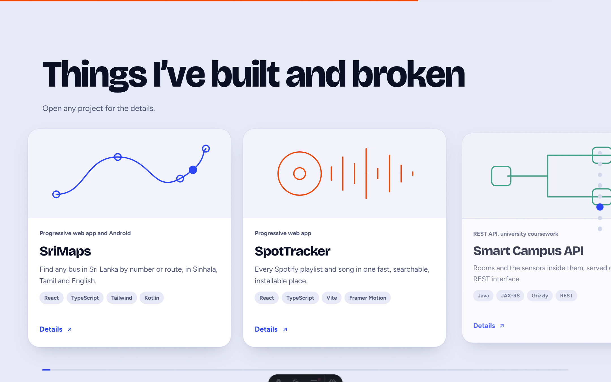
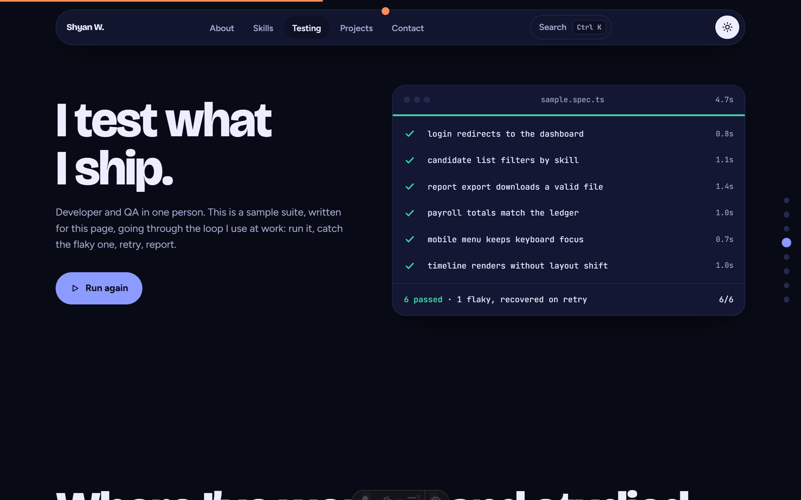
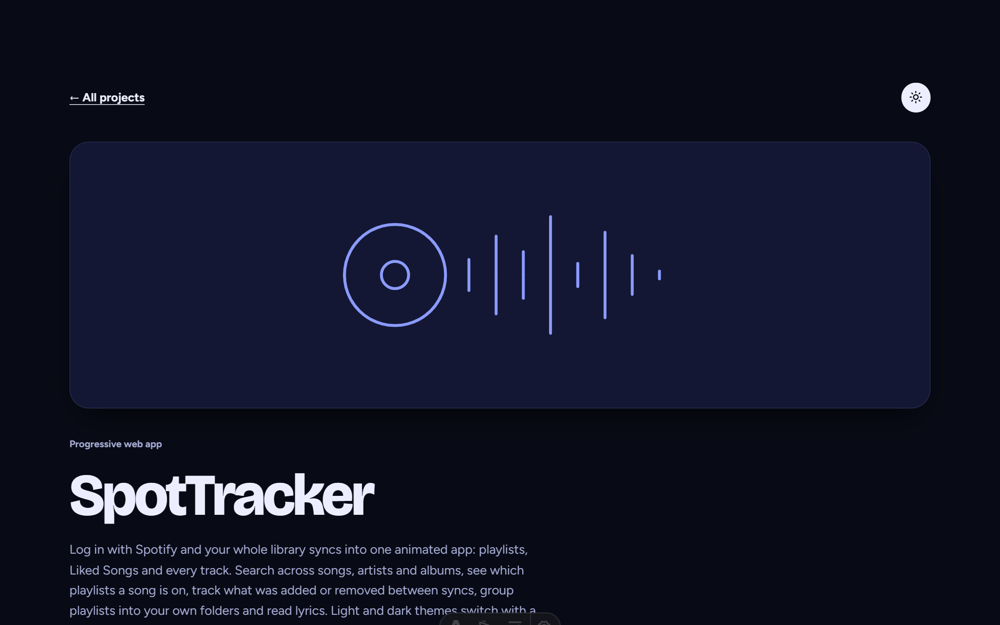
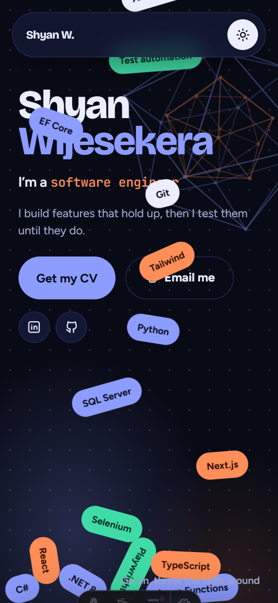

<h1 align="center">Shyan Wijesekera: Portfolio</h1>

<p align="center">
  The personal site of an intern software engineer who builds features and then tests them until they hold up.
  Animation-heavy, light and dark themes, and a skills section you can poke at.
</p>

<p align="center">
  
</p>

## What is in it

- **Hero:** name with letters that react to the cursor, a rotating role line, a typing code snippet, a wireframe 3D orb, and skill chips that fall under real physics (Matter.js) that you can throw around.
- **Skills as a terminal skill tree:** five branches that unlock as you scroll. Hover or tap any skill and a terminal prints which projects use it and what it relates to.
- **"I test what I ship":** a sample Playwright-style suite that runs, catches a flaky test and recovers on retry.
- **Experience and education:** cards with a scroll-driven progress edge that follows the rounded corners.
- **Projects:** each one opens a case-study page. Cover art morphs from the card to the page with cross-document View Transitions.
- **Command palette:** press `Ctrl K` to jump to sections or projects, switch theme, copy my email or download my CV.
- **QA mode:** press `Q` and a bug crawls across the page. Squash it and a ticket closes.
- **Light and dark themes** with a circular reveal when you switch.
- **Page transitions:** a tile-grid wipe between sections.

## A look around

<table>
  <tr>
    <td width="50%"><br /><sub><b>Light theme.</b> Same layout, warmer palette. Chips are throwable.</sub></td>
    <td width="50%"><br /><sub><b>Skill tree.</b> Hovering Playwright prints where it was used and what it relates to.</sub></td>
  </tr>
  <tr>
    <td><br /><sub><b>Projects.</b> A horizontally scrolling rail of cards.</sub></td>
    <td><br /><sub><b>Projects, light.</b></sub></td>
  </tr>
  <tr>
    <td><br /><sub><b>Testing.</b> A suite that runs on scroll, with a "Run again" button.</sub></td>
    <td><br /><sub><b>Case study.</b> One page per project, with links and stack.</sub></td>
  </tr>
</table>

<p align="center">
  
</p>

## Projects shown

| Project | What it is |
| --- | --- |
| [SriMaps](https://www.srimaps.lk/) | Find any bus in Sri Lanka by number or route, in Sinhala, Tamil and English. |
| [SpotTracker](https://spot-tracker-lyart.vercel.app/) | Every Spotify playlist and song in one searchable, installable place. |
| Smart Campus API | Rooms and sensors over REST, built on JAX-RS with an embedded Grizzly server. |
| Merch Platform | Storefront with cart, checkout, filtering and real-time search. |
| Talent Management Platform | End-to-end Playwright checks next to manual testing. |
| AI-Assisted Recruitment Platform | Features and fixes shipped through pull requests, then regression tested. |
| Enterprise HR and Payroll | Client-facing features tested with Selenium and manual passes. |

## Built with

- [Astro](https://astro.build) 7, fully static output, one page per project
- [Tailwind CSS](https://tailwindcss.com) v4
- [GSAP](https://gsap.com) (ScrollTrigger, SplitText, Flip, DrawSVG, MotionPath, ScrambleText)
- [Lenis](https://lenis.darkroom.engineering) smooth scrolling
- [Matter.js](https://brm.io/matter-js/) for the hero chip physics
- TypeScript for all page scripts

## Run it locally

You need [Node.js](https://nodejs.org) 22 or newer.

```bash
git clone https://github.com/shyanraphael/portfolio.git
cd portfolio
npm install
npm run dev
```

Open http://localhost:4321. To build the static site:

```bash
npm run build     # output in dist/
npm run preview   # serve the build locally
```

## Notes on how it behaves

- **Low-power devices:** on 4 cores or fewer, 4 GB of memory or less, or with data saver on, the site switches to a lighter mode (no physics or orb, simpler transitions). You can toggle it from the command palette.
- **Reduced motion:** if your system asks for less motion, animations are skipped and content shows at once.
- **Fail-safe:** if a scroll animation ever fails to start, content that has been on screen for a moment is revealed anyway, so nothing stays hidden.
- **Returning visitors:** the loader plays once per session.
- **Portrait:** the hero portrait shows on screens 980px wide and up.

## Project layout

```text
src/
  data.ts            profile, skills, projects, experience, article
  pages/             index.astro and projects/[id].astro
  scripts/           core, hero, sections, extras, theme, env
  styles/global.css  design tokens and all component styles
  components/        Icon.astro
public/              portrait, favicons, CV
docs/screenshots/    images used in this README
```

## Contact

- Email: shyanraphael@gmail.com
- [LinkedIn](https://www.linkedin.com/in/shyan-wijesekera)
- [GitHub](https://github.com/shyanraphael)
